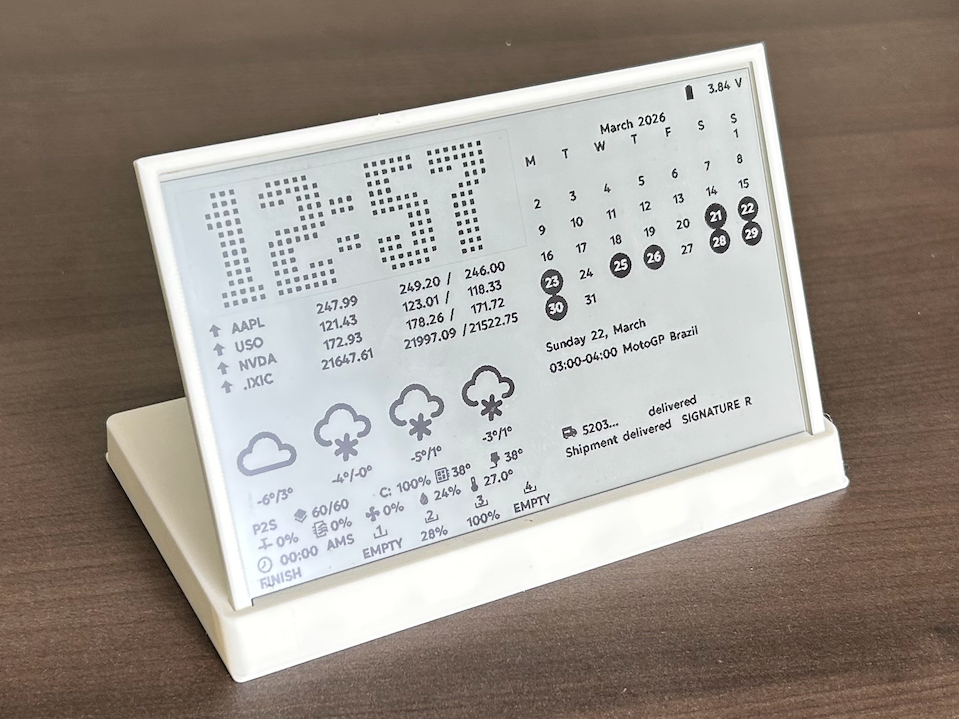
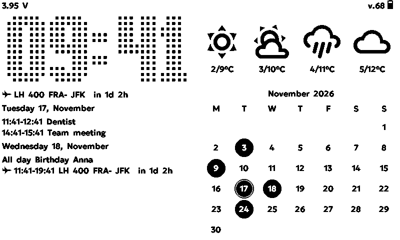

# ESP32 ePaper Desk Dashboard (fork)



A low-power 7.5" ePaper dashboard for ESP32 / ESP32-C6 boards: clock, calendars (flights highlighted),
weather, stocks, parcels, Bambu Lab printer and MakerWorld statistics. Everything is set up from a web
page served by the device itself; it talks to each service directly, with no cloud in between.

This is a fork of [VoIPshare/ESP32-eInk-Dashboard](https://github.com/VoIPshare/ESP32-eInk-Dashboard),
being turned step by step into a modular dashboard for family devices, with secure over-the-air updates
and phone setup. Progress: [implementation plan](docs/IMPLEMENTATION_PLAN.md), [changelog](CHANGELOG.md).



Four layouts (Classic, Planner, Minimal, Technical) are chosen on the setup page; see the
[user guide](docs/USER_GUIDE.md#layouts).

## Hardware

| Part | Model |
|---|---|
| Board | DFRobot FireBeetle 2 ESP32-C6 (main target); ESP32-C6 SuperMini and classic ESP32 also build |
| Display | Waveshare e-Paper Driver HAT + 7.5" black/white 800x480 |
| Optional | LiPo battery, `TTP223` touch module (or a push button to 3V3) |

Wiring and switch settings: [docs/PROJECT_INFO.md](docs/PROJECT_INFO.md#hardware).

## Quick start

1. **Build and flash** (needs [arduino-cli](https://arduino.github.io/arduino-cli/); the profile installs the
   right core and libraries):
   ```bash
   arduino-cli compile --profile esp32c6_firebeetle -u -p COM3 .
   ```
   Other boards: `esp32c6_supermini`, `esp32`, `esp32_waveshare` (see the [user guide](docs/USER_GUIDE.md#arduino-cli)).
2. **Power on.** The screen shows "ESP32 AP Mode".
3. **Join the Wi-Fi `Dashboard-Setup`**, fill in the setup page (opens by itself, or `http://192.168.4.1`) and save.

To change the settings later: hold the touch button for 4 s and release, or tap **RST** and then hold **BOOT** for 1 s.

**Updates** come over the air from this repository's releases: at night by themselves, after a double tap
on the touch button, or with **Check for updates now** on the setup page ([user guide](docs/USER_GUIDE.md#firmware-updates)).
The first firmware with updates (build 64) has to be flashed once over USB; settings are kept.

## Documentation

| Document | Contents |
|---|---|
| [User guide](docs/USER_GUIDE.md) | Widgets, setup page fields, screen behavior, wake button, building, troubleshooting |
| [Project info](docs/PROJECT_INFO.md) | Our hardware and wiring, build/flash workflow, host tests, findings |
| [Implementation plan](docs/IMPLEMENTATION_PLAN.md) | Assessment, stages, hardware test log |
| [OTA updates](docs/OTA_UPDATES.md) | Self-updating firmware: status, publishing a release, design |
| [Fonts](src/ui/fonts/README.md) | Font conversion (`tools/ListFontConvertV4.py`) |

## Repository layout

| Path | Contents |
|---|---|
| `ESP32-eInk-Dashboard.ino` | `setup()` / `loop()` only: the firmware is in `src/` |
| `configure.h`, `sketch.yaml`, `partitions.csv` | Compile options and pin presets, build profiles (core + library versions), flash layout (must stay next to the sketch) |
| `src/core/` | Wake cycle (`App`), wake decisions (`WakePlan`), settings (`ConfigManager`), log with secret masking |
| `src/hardware/` | Pins, e-paper driver, battery, touch sensor / BOOT button, SuperMini LED |
| `src/services/` | Weather, stocks, calendar (iCal), tracking, flights, MakerWorld, Bambu printer, Wi-Fi, time; verified HTTPS |
| `src/layout/` | Layout engine and templates (pure C++, tested on the PC) |
| `src/widgets/`, `src/ui/` | Drawing of the dashboard (widget registry, full-screen drawing); fonts (`src/ui/fonts/`, conversion notes there) and the canvas everything draws on |
| `src/web/`, `src/update/`, `src/input/` | Setup page; over-the-air updates; button gestures |
| `tests/host/` | Tests that run on the PC (`tests/host/run.sh`) |
| `app.h` | Settings buffers shared by the firmware |
| `tools/render/` | Renders the dashboard on the PC into PNG images (`render.sh`) |
| `tools/` | Display bring-up test, font converter, VS Code IntelliSense setup, release manifest (`tools/ota/`) |
| `docs/` | Documentation and images |
| `.github/workflows/` | CI: builds every profile on each push, size check, manual releases |

## Credits and licenses

- Original project: [VoIPshare/ESP32-eInk-Dashboard](https://github.com/VoIPshare/ESP32-eInk-Dashboard) by VoIPshare.
  The upstream repository has no license file yet (asked upstream); this fork is for personal and family use.
- Material Design Icons: [materialdesignicons.com](https://materialdesignicons.com/), Apache 2.0.
- Montserrat: [Google Fonts](https://fonts.google.com/specimen/Montserrat), SIL Open Font License 1.1.
- HighSpeed: [dafont.com/high-speed.font](https://www.dafont.com/high-speed.font), free for personal use;
  commercial use requires permission.
