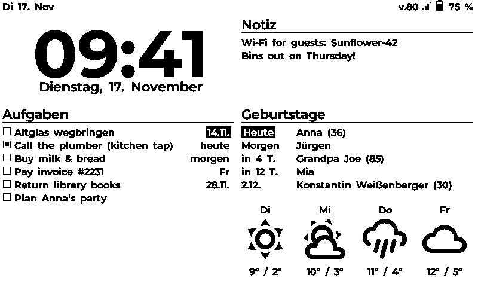

# ESP32 ePaper Desk Dashboard (fork)


A low-power 7.5" ePaper dashboard for ESP32 / ESP32-C6 boards: clock, calendars (flights highlighted),
weather, stocks, parcels, Bambu Lab printer, MakerWorld statistics, and your own tasks, note and
birthdays. Everything is set up in a setup app served by the device itself (phone or computer, no
internet needed); the device talks to each service directly, with no cloud in between.

This is a fork of [VoIPshare/ESP32-eInk-Dashboard](https://github.com/VoIPshare/ESP32-eInk-Dashboard),
being turned step by step into a modular dashboard for family devices, with secure over-the-air updates
and phone setup. Progress: [implementation plan](docs/IMPLEMENTATION_PLAN.md), [changelog](CHANGELOG.md).



Five ready-made layouts (Classic, Planner, Minimal, Technical, Personal), or your own boxes from the
layout editor, chosen on the setup app's Screen tab; see the [user guide](docs/USER_GUIDE.md#layouts).

## Hardware

| Part | Model |
|---|---|
| Board | DFRobot FireBeetle 2 ESP32-C6 (main target); ESP32-C6 SuperMini and classic ESP32 also build |
| Display | Waveshare e-Paper Driver HAT + 7.5" black/white 800x480 |
| Optional | LiPo battery, `TTP223` touch module (or a push button to 3V3) |

Wiring and switch settings: [docs/PROJECT_INFO.md](docs/PROJECT_INFO.md#hardware).

## Quick start

1. **Build and flash** (needs [arduino-cli](https://arduino.github.io/arduino-cli/); the profile installs the
   right core and libraries):
   ```bash
   arduino-cli compile --profile esp32c6_firebeetle -u -p COM3 .
   ```
   Other boards: `esp32c6_supermini`, `esp32`, `esp32_waveshare` (see the [user guide](docs/USER_GUIDE.md#arduino-cli)).
2. **Power on.** The screen shows **Setup mode** with a Wi-Fi name, a password and a QR code.
3. **Scan the QR code on the screen** (Wi-Fi `Dashboard-Setup`, password on the screen) and follow the setup app (opens by itself, or `http://192.168.4.1`).

To change the settings later: hold the touch button for 4 s and release. With working Wi-Fi the app
opens on your home network (**edit mode**, address and code on the screen); otherwise setup mode starts
again. Without a button: tap **RST**, then hold **BOOT** for 1 s (always setup mode).

**Updates** come over the air from this repository's releases: at night by themselves, after a double tap
on the touch button, or with **Check for updates now** in the setup app (Device tab)
([user guide](docs/USER_GUIDE.md#firmware-updates)).
The first firmware with updates (build 64) has to be flashed once over USB; settings are kept.

## Documentation

| Document | Contents |
|---|---|
| [User guide](docs/USER_GUIDE.md) | Widgets, the setup app, layouts, battery and power, wake button, updates, building, troubleshooting |
| [Project info](docs/PROJECT_INFO.md) | Our hardware and wiring, build/flash workflow, host and web tests |
| [Implementation plan](docs/IMPLEMENTATION_PLAN.md) | Assessment, stages: what gets implemented |
| [Device tests](docs/DEVICE_TESTS.md) | Per stage: the checks on the real device that confirm it, and the results log |
| [Stage plans](docs/plans/) | Detailed plan and result of each stage |
| [OTA updates](docs/OTA_UPDATES.md) | Self-updating firmware: how it works, signing, publishing a release |
| [OTA tests](docs/OTA_TESTS.md) | Broken-update tests on the beta channel |
| [Setup app API](docs/SETUP_API.md) | JSON interface between the setup app and the firmware |
| [Adding a widget](docs/ADD_A_WIDGET.md) | Steps for a new widget |
| [Fonts](src/ui/fonts/README.md) | Font conversion (`tools/ListFontConvertV4.py`) |

## Repository layout

| Path | Contents |
|---|---|
| `ESP32-eInk-Dashboard.ino` | `setup()` / `loop()` only: the firmware is in `src/` |
| `configure.h`, `sketch.yaml`, `partitions.csv` | Compile options and pin presets, build profiles (core + library versions), flash layout (must stay next to the sketch) |
| `app.h` | Settings buffers shared by the firmware |
| `src/core/` | Wake cycle (`App`), wake decisions (`WakePlan`), power decisions (`PowerPlan`), settings (`ConfigManager`), log with secret masking and the stored diagnostics log (`Logger`) |
| `src/hardware/` | Pins, e-paper driver, battery, touch sensor / BOOT button, SuperMini LED |
| `src/services/` | Weather, stocks, calendar (iCal), tracking, flights, MakerWorld, Bambu printer, Wi-Fi, time; verified HTTPS |
| `src/layout/` | Layout engine, templates and box layouts (pure C++, tested on the PC) |
| `src/personal/` | Tasks, note and birthdays, stored on the user-data partition (LittleFS) |
| `src/widgets/`, `src/ui/` | Drawing of the dashboard (widget registry, full-screen drawing); fonts (`src/ui/fonts/`, conversion notes there), QR codes (`src/ui/qr/`) and the canvas everything draws on |
| `src/web/` | Setup and edit mode: serves the setup app, its JSON API, the old `/basic` page; `generated/WebApp.h` is the built app |
| `src/update/`, `src/input/` | Over-the-air updates; button gestures |
| `web/` | Source of the setup app (`index.html`, `app.js`, `layout.js`, `app.css`); `web/dev/` runs it on the PC against a fake device |
| `tests/host/`, `tests/web/` | Tests that run on the PC (`tests/host/run.sh`, `node --test tests/web/*.test.cjs`) |
| `tools/web/build.py` | Builds `web/` into `src/web/generated/WebApp.h` (run it after every change in `web/`) |
| `tools/render/` | Renders the dashboard on the PC into PNG images (`render.sh`) |
| `tools/` | Display bring-up test (`epd_test/`), font converter, VS Code IntelliSense setup, release manifest and signing key (`ota/`), local build of all profiles (`dev/build_all.sh`) |
| `docs/` | Documentation and images |
| `.github/workflows/` | CI: tests, builds every profile on each push, size check, manual releases, OTA test releases |

## Credits and licenses

- Original project: [VoIPshare/ESP32-eInk-Dashboard](https://github.com/VoIPshare/ESP32-eInk-Dashboard) by VoIPshare.
  The upstream repository has no license file yet (asked upstream); this fork is for personal and family use.
- Material Design Icons: [materialdesignicons.com](https://materialdesignicons.com/), Apache 2.0.
- Montserrat: [Google Fonts](https://fonts.google.com/specimen/Montserrat), SIL Open Font License 1.1.
- HighSpeed: [dafont.com/high-speed.font](https://www.dafont.com/high-speed.font), free for personal use;
  commercial use requires permission.
- QR Code generator library: [Project Nayuki](https://www.nayuki.io/page/qr-code-generator-library), MIT License
  (`src/ui/qr/`, setup screens).
