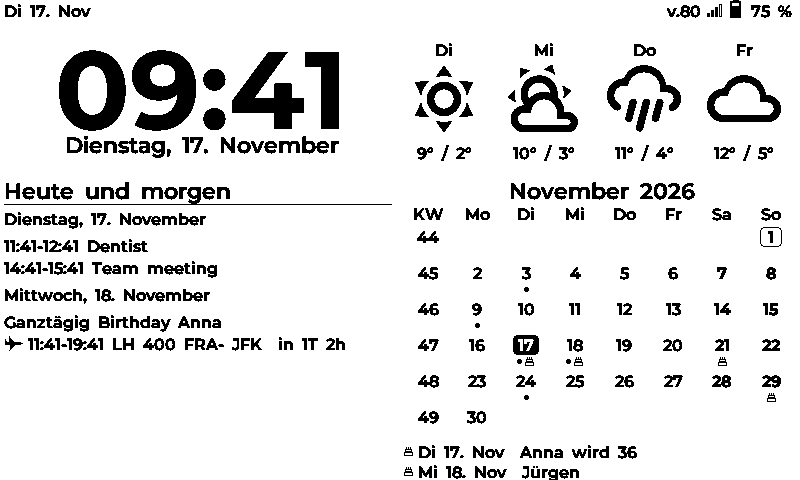
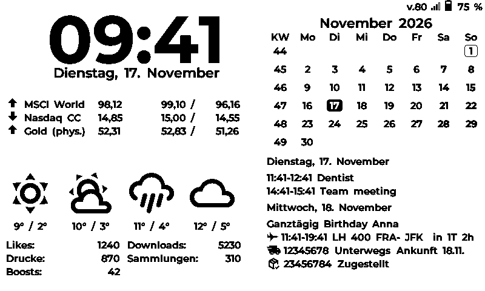
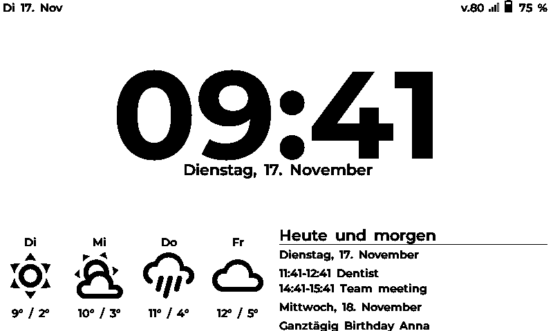
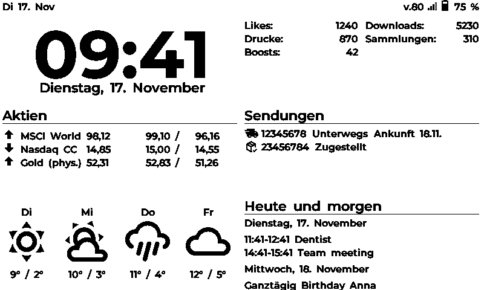
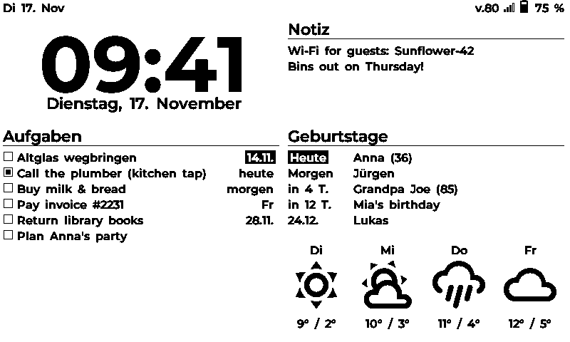
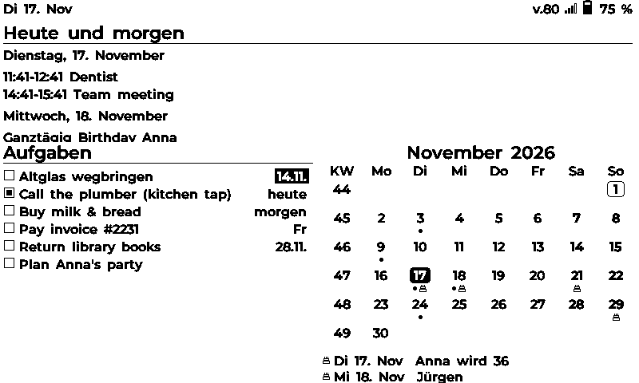
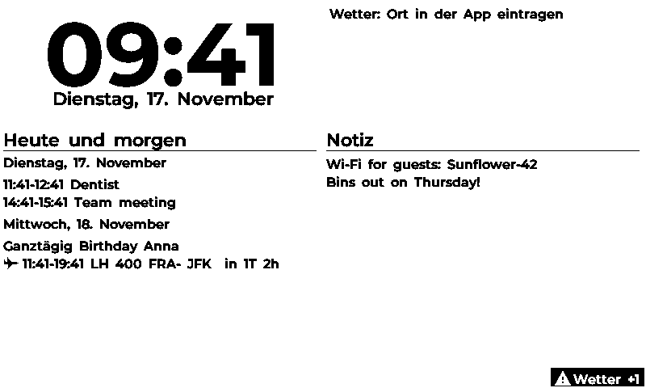

# ESP32 ePaper Desk Dashboard: user guide

The full user manual, originally the upstream project's README ([VoIPshare/ESP32-eInk-Dashboard](https://github.com/VoIPshare/ESP32-eInk-Dashboard)), kept up to date for this fork. Overview and quick links: [README](../README.md).



A low-power desk dashboard for ESP32 boards and 7.5" ePaper displays. It shows the time, your calendars (with flights highlighted), the weather, stock prices, your parcels, your Bambu Lab printer, your MakerWorld statistics, and your own tasks, note and birthdays. Everything is configured in a setup app served by the device itself: the ESP32 talks to each service directly, with no cloud scripts or servers in between.

## Contents

- [What it shows](#what-it-shows)
- [Hardware](#hardware)
- [Quick start](#quick-start)
- [The setup app](#the-setup-app)
- [Data and Device tab fields](#data-and-device-tab-fields)
- [Layouts](#layouts)
- [How the screen behaves](#how-the-screen-behaves)
- [Battery and power](#battery-and-power)
- [Tasks, note and birthdays](#tasks-note-and-birthdays)
- [Wake button](#wake-button)
- [Firmware updates](#firmware-updates)
- [Building the firmware](#building-the-firmware)
- [Troubleshooting](#troubleshooting)

## What it shows

The ESP32 fetches every widget's data itself, directly from each service:

| Widget | Data source | Needs | Refresh |
| --- | --- | --- | --- |
| Clock | internal clock, synced over NTP | time zone | every 1-30 minutes (**Clock refresh**, default every minute) |
| Status bar: date, battery, problems, firmware version | battery pin, fetch results | — | every hour, and whenever a problem appears or clears |
| Month calendar | your iCal feeds (marks days with events) | iCal URL | every hour |
| Upcoming events (next 24 h), flights highlighted | up to 3 iCal feeds, merged | iCal URL | every hour (flight countdown: every 10 min) |
| Weather (4 days) | [Open-Meteo](https://open-meteo.com/) | city or coordinates | every 6 hours |
| Stocks (up to 5) | Yahoo Finance | ticker symbols, optionally with your own names | every hour |
| Bambu Lab printer | the printer, over local MQTT | printer address, serial number, access code | every 4 min while printing, 10 min idle |
| MakerWorld stats | Bambu's MakerWorld API | MakerWorld user ID | every hour (idle only) |
| Package tracking (up to 3 lines) | [PKGE](https://business.pkge.net) | PKGE API key | every 2 hours |
| Live flight status (optional) | [AeroDataBox](https://rapid.aerodatabox.com) via RapidAPI | RapidAPI key | on the day of a flight: every 30 min, every 10 min around departure and landing |
| Tasks, note, birthdays | typed in the setup app; birthdays also from a birthday calendar link | — | when they change, and when the date changes (birthday link: once a day) |

The refresh times are rounded up to the clock refresh interval (with the clock every 5 minutes, the printer's 4 minutes become 5). Nothing is fetched during the night quiet hours, and the battery saver wakes only every 15 minutes (see [Battery and power](#battery-and-power)).

Only package tracking (a PKGE Business account) and the optional live flight status (a free RapidAPI account) need an account; everything else works without keys or accounts. In the ready-made layouts a widget only appears when its settings are filled in; in your own layouts its box says what to set up.

## Hardware

Minimum:

- an ESP32 or ESP32-C6 board
- a 7.5" GxEPD2-compatible black-and-white ePaper display (800×480)
- a Wi-Fi network

Optional:

- a LiPo battery (the battery widget reads it through a voltage divider)
- a push button (to 3V3) or `TTP223` touch module, to refresh, reboot or open the setup app
- a Bambu Lab printer on the same network

Boards used during development:

- ESP32: Lolin D32
- ESP32-C6: DFRobot FireBeetle 2 ESP32-C6
- ESP32-C6 SuperMini: MakerGO-style clone

Clone boards and display hats vary, so check the pinout if yours differs. Most color ePaper panels do not support partial refresh, and large panels can take 20+ seconds for a full refresh.

### Pin reference

| Board | CS | DC | RST | BUSY | SCK | MOSI | Display power | Battery | Button |
| --- | ---: | ---: | ---: | ---: | ---: | ---: | ---: | ---: | --- |
| ESP32-C6 SuperMini | `4` | `20` | `21` | `22` | `7` | `5` | `1` | not used | `GPIO2` |
| ESP32-C6 (FireBeetle 2) | `1` | `8` | `14` | `7` | `23` | `22` | `4` | `0` | `GPIO2` |
| ESP32 | `15` | `27` | `26` | `25` | `13` | `14` | `4` | `35` | `GPIO33` |
| ESP32 Waveshare | `15` | `27` | `26` | `25` | `13` | `14` | `33` | `35` | not used |

The firmware picks the matching preset for your board automatically. You can choose another preset, or enter a custom pin map, in the setup app (Device tab, **Advanced: board pins**). Presets are defined in [configure.h](../configure.h).

## Quick start

1. **Flash the firmware.** Use a [prebuilt release](https://github.com/Whodatboy66/ESP32-eInk-Dashboard/releases) (flash the `*.merged.bin` image at address `0x0000`, for example with the [espboards.dev programmer](https://www.espboards.dev/tools/program/); it erases all settings, which is fine on a new device), or [build it yourself](#building-the-firmware).
2. **Power on the board.** The screen shows **Setup mode** with a Wi-Fi name, a password and a QR code.
3. **Scan the QR code with your phone's camera** (or join the Wi-Fi `Dashboard-Setup` with the password on the screen). The setup app opens by itself (captive portal). If it doesn't, browse to `http://192.168.4.1`.
4. **Follow the guided setup** in the app (Wi-Fi, name and place, calendars, screen). At the end the device restarts and draws the dashboard.

To change the settings later, hold the button for 4 seconds and release it: with working Wi-Fi the app opens on your home network (**edit mode**, see [The setup app](#the-setup-app)), otherwise setup mode starts again. Without a button: tap **RST**, then press and hold **BOOT** for 1 second (always setup mode).

## The setup app

The device serves its own app (no internet needed, nothing to install). Two ways to open it:

- **Setup mode** (first start, BOOT after a reset, or a 4-second hold without working Wi-Fi): the
  device opens the hotspot `Dashboard-Setup`. Its password is made once per device and shown on the
  screen with a QR code; a factory reset makes a new one. The app opens by itself after joining.
  Setup mode closes after 5 minutes without use; on a device that was never configured it stays open
  until you save.
- **Edit mode** (4-second hold with working Wi-Fi): the app is reachable on your home network. The
  screen shows the address (`http://<name>.local`, e.g. `kitchen-display.local`, and the IP address),
  a QR code and a **6-digit code** to type in. After 5 wrong codes a new one appears. Edit mode closes
  after 10 minutes without use. **Change Wi-Fi** (Device tab) switches to setup mode.

When it closes, the dashboard comes back.

| Tab | What's there |
| --- | --- |
| **Home** | Preview, problems with what to do about them, "Update available", battery, Wi-Fi, version, **Done** |
| **Screen** | The layout editor (see [Layouts](#layouts)), 12 / 24-hour clock, **Clock refresh**, quiet hours at night |
| **Data** | Calendar links (with **Check**), weather place (search), stocks, parcels and flights keys, printer, MakerWorld; tasks, note and birthdays (with the birthday calendar link) |
| **Device** | Language, name, Wi-Fi (scan, **Test the connection**; **Change Wi-Fi** in edit mode), time zone, battery capacity, updates (automatic, channel, check now), Diagnostics, board pins (advanced), factory reset |

**Language.** German (the default) or English, chosen as the first question of the guided first start
and on the Device tab. It applies to everything the device shows (the screen, the setup and update
screens, dates, "heute / morgen", decimal commas in prices) and to the device's messages in the app
(problems, hints, check results). Your own content (calendar entries, tasks, names) stays as typed;
the diagnostics log stays in English. Changing it is a normal save (the device restarts).

**Saving.** Every changed setting is checked before anything is saved. If something can't work (an
unknown time zone, a calendar link that isn't `https://`/`http://`/`webcal://`, characters a stock
symbol can't have, a public printer address, an invalid printer port, incomplete custom pins), the
app shows what to fix next to the field and **nothing is saved**. Passwords, keys and calendar links
are never shown again once saved ("Saved ✓ — type to replace"; **Remove** deletes one). Saving settings
restarts the device; it comes back in the same mode (setup mode: the phone reconnects to the hotspot;
edit mode: same code, no new login), so you can go on; **Done** ends it. Layouts, tasks, the note and
birthdays are shown right away without a restart.

**Diagnostics** (Device tab): what the device did while nobody was looking: the recent log (download
it with **Download log**, e.g. to attach to a bug report), the battery voltage once an hour over the
last 7 days (a working LiPo stays between 3.0 and 4.2 V and rises while charging), and for weather,
stocks, calendar and parcels the last success, failures and next retry. The log keeps the wakes that
did something (Wi-Fi, a problem, a full refresh, setup mode), not the quiet clock wakes.
Over USB the same lines appear live in a serial monitor (115200 baud).

**Factory reset** (Device tab, with a confirmation) erases every setting including Wi-Fi, and the
tasks, note, birthdays and the log, then restarts into the first setup. Without the app: connect USB,
open a serial monitor at 115200 baud, tap **RST** and type `factory-reset` within 3 seconds.

## Data and Device tab fields

| Field | What to enter |
| --- | --- |
| **Time zone** (Device) | Pick a name from the list (`Europe/Berlin`, `Europe/London`, `America/New_York`, …) or type a POSIX rule including summer time: `CET-1CEST,M3.5.0,M10.5.0/3` (Germany and most of Central Europe), `GMT0BST,M3.5.0/1,M10.5.0` (UK), `EST5EDT,M3.2.0,M11.1.0` (US Eastern). Names are turned into their rule when you save; anything else is refused with a message. Used for everything the device shows and logs; without it the device runs on UTC. [List of rules](https://github.com/nayarsystems/posix_tz_db/blob/master/zones.csv). |
| **Weather place** | Type a city and pick it from the list, or type a city with a 2-letter country code (`London, GB`), or `latitude,longitude` (`51.51,-0.13`). A city is looked up once with Open-Meteo's geocoding. |
| **Stock symbols** | Up to 5 Yahoo Finance symbols, separated by commas: `AAPL,NVDA,^IXIC`. Indexes start with `^`; other exchanges have a suffix (`.DE` Xetra, `.L` London, `.AS` Amsterdam), and prices are shown in that exchange's currency. **Own names** (build 78): `SYMBOL:Name`, up to 12 characters, e.g. `EUNL.DE:MSCI World,QYLE.DE:Nasdaq CC,PPFB.DE:Gold`: the screen then shows the name instead of the symbol. Find a symbol with the search on finance.yahoo.com. |
| **Calendar links** | Up to 3 `.ics` links (`https://`; `webcal://` and `http://` links are turned into `https://`), merged into one calendar. **Check** tries a link (needs internet on the device). See [Getting your Google Calendar link](#getting-your-google-calendar-link). The server's certificate is checked: Google, iCloud, Outlook and servers with a normal certificate work; a self-hosted server with a self-signed certificate, or one that sends an incomplete certificate chain (`cert.pem` instead of `fullchain.pem`), doesn't. |
| **Birthday calendar link** | Optional `.ics` link with birthdays (e.g. Google Calendar's birthdays), read once a day. |
| **Parcels key (PKGE)** | The API key of your PKGE Business account, for package tracking (see [Tracking your packages](#tracking-your-packages)). |
| **Flights key (AeroDataBox)** | Optional: your RapidAPI key, for live flight status (see [Live flight status](#live-flight-status-optional)). |
| **Printer name** | Title shown on the printer widget. |
| **Printer address** | The printer's address in your home network (e.g. `192.168.1.100`) or its name there (`x1c.local`, or a name your router knows, like `printer.fritz.box`). Leave empty if you don't use the printer's LAN connection: with a MakerWorld user ID the widget then shows only the MakerWorld stats. The printer status is only fetched when address, serial number and access code are all set. A printer that doesn't answer (switched off) is asked again after 10, 20, 40, then every 60 minutes. Only local addresses are used: the printer's connection is the one without a certificate check (the printer only has a self-signed one), so a name that resolves to a public address is refused when connecting (serial log: `not in the local network`). |
| **Serial number** | On the printer screen under Settings → Device, or in Bambu Studio. |
| **Access code** | On the printer screen under Settings → WLAN / Network → Access Code. |
| **Port** | `8883` (the default; MQTT over TLS). |
| **MakerWorld user ID** | The numeric ID of your MakerWorld account (see [below](#finding-your-makerworld-user-id)). Shown when no print is running. |
| **Board** (Device, advanced) | Your board's wiring. Pick **Custom** to enter your own pins. |
| **Update channel** (Device) | **Stable** (default) or **Beta**: beta also gets test releases first. Use beta only on a device you can reach. |
| **Install updates by themselves** (Device) | On (default): a new firmware version is installed at night by itself. Off: the status bar shows `Update available`; install it with a double tap or **Check for updates now**. See [Firmware updates](#firmware-updates). |

Settings are stored in the board's flash and survive firmware updates, unless you erase the flash when uploading.

### Getting your Google Calendar link

1. Open [Google Calendar](https://calendar.google.com) on a computer and go to **Settings**.
2. Under **Settings for my calendars**, pick the calendar.
3. Open **Integrate calendar** and copy one of these:
   - **Public address in iCal format**: works only if the calendar is public.
   - **Secret address in iCal format**: works for a private calendar. Treat it like a password: anyone with it can read your calendar.

Any other service that publishes an `.ics` link (Outlook, iCloud, Nextcloud, …) works too.

### Flights

Flights in your calendars get a small plane icon (shown as ✈ in the examples below) and a countdown to departure. Nothing to configure: add the flight to any of your calendars with a title like one of these:

| Calendar title | Recognized because |
| --- | --- |
| `TS399 PUJ->YUL` | flight number + route |
| `AC 871 YUL to YYZ` | flight number + route |
| `WS1234 YUL→YYC`, `AC871 YUL/YYZ` | flight number + route |
| `Flight to Toronto (AC 871)` | contains the word "flight" |

A flight number is a 2-character airline code followed by 1–4 digits (`TS399`, `AC 871`); a route is two 3-letter airport codes joined by `->`, `→`, `-`, `/` or `to`. Titles containing "flight" or ✈ always count. Ordinary titles such as "PS4 game night" or "Q3 review" are not mistaken for flights. Flights added automatically by Gmail or TripIt already use these formats.

On screen:

- **More than 24 hours away (up to 7 days):** pinned at the top of the events list, e.g. `✈ TS399 PUJ->YUL  in 3d 4h`.
- **Within 24 hours:** shown in the events list with its time and a countdown, e.g. `✈ 14:05-18:30 TS399 PUJ->YUL  in 5h20m`, refreshed every 10 minutes.

Without an AeroDataBox key, the countdown uses the departure time of the calendar event, so it doesn't reflect delays.

#### Live flight status (optional)

With an AeroDataBox key, the dashboard follows the next flight from **6 hours before departure until it lands** (it stops when the flight has landed or was canceled, 1 hour after the actual landing at the latest, and for safety never more than 3 hours after the scheduled landing or after 30 requests), checking every 30 minutes (every 10 minutes in the hour around departure and around landing), and shows a second line under the flight. The first line then uses the real (gate) departure and arrival times instead of the calendar's, and the countdown includes delays:

```
✈ 14:50-19:15 TS399 PUJ->YUL  in 3h55m
  Delayed +45m, gate B7, Terminal B
```

The gate appears once the airline publishes it, usually an hour or two before departure; numeric terminals are shown short (`T1`). The line becomes `In the air, lands 19:15` after take-off, `Landed 19:12` on arrival, or `CANCELED`. Other states shown: On time, Check-in, Boarding, Gate closed, Diverted.

To get a key:

1. Create a free account at [rapidapi.com](https://rapidapi.com) (no separate AeroDataBox account is needed).
2. Open the AeroDataBox API ([rapid.aerodatabox.com](https://rapid.aerodatabox.com)) and subscribe to the free **Basic** plan.
3. Copy your **X-RapidAPI-Key** into **Flights key (AeroDataBox)** on the app's Data tab.

The flight number comes from the calendar title (`TS399`), and only the day of the flight uses requests, about 15–20 per flight. Check the plan's monthly quota on RapidAPI. If the flight can't be found or the service fails, the line falls back to the calendar time and `Flight` appears in the status bar.

### Finding your MakerWorld user ID

Open your MakerWorld profile, open your published models list, and look for the long number in the page address or in your browser's network requests to `/design-service/published/<number>/design`. That number is your user ID.

### Tracking your packages

Packages are managed in your **PKGE** account; the dashboard only reads them. You never have to type tracking numbers on the device.

1. Create an account at [business.pkge.net](https://business.pkge.net).
2. In your account, open the **Company profile → API key** section and copy the key.
3. Paste it into **Parcels key (PKGE)** on the app's Data tab.
4. Whenever you order something, add the tracking number in the PKGE web dashboard and pick the carrier (or let PKGE detect it). The dashboard picks it up within 2 hours.

The tracking widget shows one line per package: an icon (truck = in transit or preparing, box with check = delivered, ⚠ = delivery problem, plain box = anything else), the **last 8 characters** of the tracking number, the status, and the estimated delivery date when the carrier provides one. For example (the emoji stand for the icons):

```
🚚 23197428  In transit  ETA Oct 14
📦 AA101234  At pickup point
✅ 89CN0042  Delivered
```

Packages still on their way come first, newest update first. Delivered packages stay visible for 1 day after delivery, then disappear from the screen; they remain in your PKGE account, so delete them there when you no longer need them.

| PKGE status | Shown as |
| --- | --- |
| 0, 1 | Checking |
| 2 | No info yet |
| 3 | In transit |
| 4 | At pickup point |
| 5 | Delivered |
| 6 | Not delivered |
| 7 | Delivery error |
| 8 | Preparing |
| 9 | Route ended |

### Bambu Lab printer requirements

- The printer and the dashboard must be on the same network.
- The dashboard logs in with the user `bblp` and the LAN access code, like other local tools (Home Assistant, Bambu Buddy, …). On recent firmware this requires LAN mode or Developer Mode to be enabled on the printer.
- The access code can change when LAN or Developer Mode is toggled. If the printer widget stops updating, re-enter the code.

## Layouts

Chosen on the app's Screen tab. The first row offers the ready-made layouts (Classic, Planner,
Minimal, Technical, Personal), the second row empty structures to start your own.

| Classic | Planner |
| --- | --- |
|  |  |
| **Minimal** | **Technical** |
|  |  |
| **Personal** | |
|  | |

The grid layouts use 4 × 3 cells below the status bar. A widget that isn't set up leaves no gap:
its neighbor grows into the free space. Examples: [Planner without weather](images/layouts/planner-no-weather.png),
[Minimal with only the clock](images/layouts/minimal-clock-only.png),
[Technical without stocks and parcels](images/layouts/technical-no-stocks-tracking.png),
[12-hour clock](images/layouts/minimal-12h.png).

**Classic** keeps the original fixed screen; its **Show on Classic** switches choose the widgets, and
a missing widget leaves its place empty:

| Left column (x 10–440) | Right column (x 440–800) |
| --- | --- |
| Clock (top) | Status bar: battery, problems, version |
| Stocks | Month calendar |
| Weather | Upcoming events |
| Printer / MakerWorld | Package tracking (bottom) |

### Layout editor

1. Pick a ready-made layout, or a **structure** (Full, Halves, Top + main, Top + 2, Four, Main + side,
   Six, Big + 2 small).
2. Tap a box and choose what it shows. Widgets that need more room are greyed out ("needs 2 × 2").
3. **Split** a box in two or **merge** it with a neighbor. A 2 × 2 box splits into two 2 × 1 boxes.
4. Optional: switch the **status bar** off (the boxes get the full height; problems then appear as a
   small mark in the bottom-right corner).
5. **Show on the display**. **Exact preview** asks the device for the exact picture first.

There is no clock unless you place one. A box can stay empty. A widget whose settings are missing
shows what to set up in its box ("Weather: set a place in the app").

| Top row agenda, no clock | Without status bar |
| --- | --- |
|  |  |

A layout change is drawn with a full refresh. The 12-hour clock shows AM/PM where it fits; in a
2-cell clock "12:58" fills the place, so there only the time is shown. Event times in the agenda
stay in 24-hour format for now.

These images are drawn on the PC with the firmware's own drawing code (`tools/render/render.sh`).
Adding a widget: [ADD_A_WIDGET.md](ADD_A_WIDGET.md).

## How the screen behaves

### Refresh timing

- The device sleeps between updates and wakes **about half a second after each clock refresh
  interval starts** (every minute by default; with 5 minutes at :00, :05, …). The clock is redrawn
  first, before any network activity. A wake that only redraws the clock keeps the board awake for
  a few seconds. During the night quiet hours it doesn't wake at all (see [Battery and power](#battery-and-power)).
- Wi-Fi is only turned on when a widget is due for new data (see the table at the top). The time is re-synced over NTP at least once an hour, because the internal clock drifts during deep sleep.
- To save battery, wakes that only redraw the clock run the CPU at 80 MHz, and Wi-Fi reconnects straight to the access point used last time instead of scanning every channel.
- If Wi-Fi can't connect, the device waits before trying again: 2, 4, 8, 16, then 30 minutes. A button tap always tries right away.
- If a download fails, the widget keeps its last data and the device tries again after 2, 4, 8 and
  16 minutes (never later than its normal refresh); after that only at its normal refresh, so a
  permanent error (a misspelled city, a wrong key) doesn't keep Wi-Fi busy. When the data is older than
  two refresh intervals (at least 30 minutes), the widget shows a small **old** badge in its corner
  ([example](images/layouts/planner-stale.png), [Classic](images/layouts/classic-stale.png)).
  The printer has its own wait (10, 20, 40, then 60 minutes, see the [printer address](#data-and-device-tab-fields)).
- Widgets are updated with partial refreshes. A full screen refresh, which removes ghosting, happens once a day, after setup, after a button wake, after a layout change, in the morning after the quiet hours, and when the battery is charged again after the "please charge" screen.

### Status bar and problem indicator

The status bar shows, from left to right: the date (in full-width layouts; the clock has no room for
it), the battery in percent, a note when something is special ("Night until 06:00", "Battery saver:
every 15 min", "Clock every 5 min"), any **current problems**, the firmware version, and icons for
printing and the battery level.

The battery level comes from a typical LiPo discharge curve (about 4.15 V = 100 %, 3.83 V = 50 %, 3.3 V = 0 %), not a straight line. The voltage is read with the chip's factory ADC calibration and averaged over 16 samples; the voltage itself is in the log and in Diagnostics. While USB is plugged in, the charger holds the voltage high, so the icon reads full. If the voltage differs from a multimeter, set `BAT_CALIBRATION` in [src/hardware/BatteryMonitor.cpp](../src/hardware/BatteryMonitor.cpp) to *multimeter ÷ measured* (for example 4.12 ÷ 4.05 = 1.017). The debug log prints `[Battery] 4.05 V, 90%` on each status-bar refresh. A reading below 3.0 V (or above 4.4 V) can't be a LiPo running the board: the status bar then shows `USB` instead of a percentage (no battery connected, or the battery pin can't measure it), and updates are allowed.

When a data source fails, a ⚠ icon appears, followed by the names of what is failing:

| Shown | Meaning |
| --- | --- |
| `WiFi` | The device couldn't join your Wi-Fi network. |
| `Time` | The hourly internet time sync failed. |
| `Weather` | The Open-Meteo forecast couldn't be loaded. |
| `Stocks` | One or more stock symbols couldn't be loaded (often a typo in a symbol). |
| `Calendar` | One or more iCal links couldn't be loaded. |
| `Printer` | The printer didn't answer (off, wrong address, or wrong serial number). |
| `Access code` | The printer rejected the LAN access code. |
| `MakerWorld` | The MakerWorld stats couldn't be loaded. |
| `Tracking` | The package list couldn't be loaded from PKGE (often a wrong API key). |
| `Flight` | The live flight status couldn't be loaded (wrong key, quota used up, or flight not found). |
| `Birthdays` | The birthday calendar link couldn't be loaded. |

Each problem clears by itself the next time that source loads successfully. If there's not enough room, the remaining ones are summarized as `+N`. The app's Home tab lists the same problems with what to do. The serial log has the details (see [Troubleshooting](#troubleshooting)).

### Printer and MakerWorld panel

The printer panel switches automatically:

- **While printing:** printer status: layer, progress, temperatures, fans, remaining time, AMS trays and humidity.
- **For 5 minutes after a print ends:** printer status, so you can see the finished state.
- **Otherwise:** MakerWorld totals: likes, downloads, prints, collections and boosts, summed over all your published models.

If no MakerWorld ID is set, the panel shows the idle printer status instead.

## Battery and power

Set in the setup app (Screen tab):

- **Clock refresh:** every 1, 2, 5, 10, 15 or 30 minutes. The display wakes this often and shows the
  time of that moment ("9:45" until 9:50 with 5 minutes); the status bar says "Clock every 5 min". The
  app shows the estimated days per charge for each choice. Most of the battery goes into these wakes:
  every 5 minutes lasts about 2.5 times as long as every minute.
- **Quiet hours at night** (default 23:00-06:00, can be changed or switched off): no updates at all;
  the display keeps its last picture and the status bar says "Night until 06:00". A tap shows the
  current dashboard; in the morning everything is refreshed. If the quiet hours cover 03:00, the daily
  update check runs at their end.
- **Battery saver** (automatic): below 20 % the display updates every 15 minutes ("Battery saver: every
  15 min"), until the battery is above 30 % again or a computer's USB is connected. Below 5 % it shows
  "Battery empty: please charge" and only checks the battery once an hour; once it's charged above
  10 % the dashboard comes back by itself.
- **Battery capacity** (Device tab, default 3000 mAh): only used for the estimates.

The estimates come from the first measured battery use (about 20 days per charge with every minute,
no quiet hours, 3000 mAh) and will be replaced by real current measurements.
[Status bar at night](images/layouts/planner-night.png), [battery saver](images/layouts/classic-saver.png).

## Tasks, note and birthdays

Three widgets with your own data, stored on the device (they stay through restarts and updates; a
factory reset erases them). They appear in the **Personal** layout, or in any layout where you place
them, as soon as there is something to show.

- **Tasks:** up to 30, each with an optional due date and a priority. The screen shows the open ones:
  overdue first (date in a black box), then by due date ("today", "tomorrow", a weekday, or the
  date), then by priority (a filled box = high). "+3 more" when they don't all fit. Done tasks aren't
  shown; they are deleted 30 days after they were ticked off.
- **Note:** one note of up to 400 characters, line breaks kept; cut with "…" if it doesn't fit.
- **Birthdays:** the next 60 days, from a list you type in (up to 50, with the year for the age) and
  from a **birthday calendar link** (Data tab, e.g. Google Calendar's birthdays as an iCal link,
  read once a day). "Today" is shown in a black box.

They are edited on the app's Data tab (setup or edit mode). The screen font shows German umlauts, ß,
€ and common punctuation; other characters (emoji, for example) are removed when saving.
[Example with long texts](images/layouts/personal-long.png).

## Wake button

The button is optional. Without it, the device wakes on its timer only.

It is an active-HIGH input with the internal pull-down: a `TTP223` module with its default settings (solder jumpers A and B open) or a push button between the pin and 3V3. An unconnected pin reads "not pressed". The `TTP223` calibrates itself at power-up, so don't touch it while powering on.

| Action | Result |
| --- | --- |
| Short tap | Wakes the device and does a full refresh (at night: shows the current dashboard) |
| Double tap | Device info and update check (see [Firmware updates](#firmware-updates)) |
| Hold 2 seconds, then release | Reboots the dashboard |
| Hold 4 seconds, then release | Edit mode on the home network (code on the screen); setup mode (`Dashboard-Setup`) when Wi-Fi doesn't work |
| Held 15 seconds or longer | Treated as a sensor fault and ignored (see below) |

Releasing before 2 seconds counts as a short tap; a second tap within 0.4 seconds makes it a double tap (so a single tap's refresh starts 0.4 seconds later). From deep sleep, the first tap wakes the device and the second is caught after it starts: tap twice at a calm pace rather than very fast. Releasing between 2 and 4 seconds reboots, between 4 and 15 seconds opens edit or setup mode. The holds also work while the dashboard is awake and refreshing; a short tap then is ignored. On the ESP32-C6 SuperMini, the onboard LED shows the stage: green while holding, flashing cyan from 2 s (release to reboot), flashing white from 4 s (release for setup).

**Sensor fault:** if the input reads "pressed" for 15 seconds (a stuck, miswired or recalibrating sensor), the press is ignored, and the device stops waking on the button, using its timer only, until the input reads "not pressed" again. The dashboard keeps running.

**Without a working button (BOOT backup):** tap **RST**, then within 3 seconds press and hold the board's **BOOT** button for 1 second: the device opens setup mode. Don't hold BOOT while tapping RST, which starts the chip's download mode instead. The BOOT pin is `GPIO9` on ESP32-C6 boards and `GPIO0` on ESP32 boards; this is skipped if a custom pin map uses that pin.

## Firmware updates

The device updates itself from the releases of its GitHub repository; settings are kept.

- **Automatically:** once a day, from 03:00 until noon (at the first wake after 03:00, or at the end of the quiet hours if they cover 03:00), it checks for a new version. With **Install updates by themselves** on, it installs it right away; with it off, the status bar shows `Update available` next to the version until you install it. A version that was installed once and rolled back is not installed automatically again; a double tap still installs it.
- **Double tap:** shows the device info (version, channel, last update, battery, Wi-Fi) and checks. If there is a new version, the screen shows it with up to 3 "New in this version" lines and **Tap to install - cancels in 15 s**: tap once to install; without a tap the dashboard returns.
- **Channel:** stable devices only get regular releases; beta devices also get test releases (Device tab, **Update channel**). Switching from beta back to stable never goes back to an older version: the device stays on its beta build until a newer stable build exists.
- **Setup app:** **Check for updates now** (Device tab), or **Install now** on the Home tab when an update is waiting, restarts the device, which goes online, checks and installs a new version without asking. The screen shows the progress; the app shows the last result next time.

An install shows its steps on the screen (Downloading, Verifying, Installing, Restarting), then **Updated to .76** with what's new, then the dashboard. Messages in plain language:

| Message | Meaning |
| --- | --- |
| `Up to date: .76` | No newer version |
| `No Wi-Fi: try again later` | The device couldn't connect |
| `No update for this device` | The release has no file for this board or display, or can't read this device's settings |
| `Update check failed: try again later` | GitHub couldn't be reached, there is no release yet, or the release signature isn't valid (then it is never installed) |
| `Battery too low for an update: please charge` | Below 30 % and no USB seen: charge it, the next check tries again. USB is seen only when a computer is connected; on a USB charger the battery reading decides. Without a measured battery (status bar `USB`) updates are allowed |
| `Update failed: previous version kept` | The download or install failed, or the new version didn't start or couldn't reach Wi-Fi (it rolls back by itself) |
| `Update needs a USB install` | The new version can't be installed over the air from this one |

After an update the new version confirms itself once Wi-Fi and the display worked; until then (at most 3 minutes) any crash, hang or restart returns to the previous version. Using the button in that time (a hold, setup or edit mode, the update screen) also confirms it.

The first firmware with updates needs one USB flash (it changes the flash layout): `arduino-cli upload` keeps the settings, the `*.merged.bin` image erases them. After that, no cable is needed. Maintainers: publishing a release is described in [OTA_UPDATES.md](OTA_UPDATES.md#publishing-a-release).

## Building the firmware

### Arduino IDE

1. Install the **esp32** board package by Espressif (3.3.x).
2. Install the libraries: **GxEPD2**, **Adafruit GFX Library**, **Adafruit BusIO**, **ArduinoJson** (7.x), **PubSubClient** (the versions used are in [sketch.yaml](../sketch.yaml)).
3. Open [ESP32-eInk-Dashboard.ino](../ESP32-eInk-Dashboard.ino) and select your board.
4. For ESP32-C6 boards, set **Tools → USB CDC On Boot → Enabled**, otherwise the serial log goes to the UART pins instead of USB.
5. Compile and upload.

### arduino-cli

The repo includes [sketch.yaml](../sketch.yaml) profiles:

```bash
arduino-cli compile --profile esp32 .
arduino-cli compile --profile esp32_waveshare --build-property "compiler.cpp.extra_flags=-DDEFAULT_PIN_PRESET_ESP32_WAVESHARE" .
arduino-cli compile --profile esp32c6_firebeetle .
arduino-cli compile --profile esp32c6_supermini .
```

Add `-u -p <port>` to upload. The profiles pin the core and library versions (CI uses the same profiles). arduino-cli ignores build properties in profiles, so the pin preset comes from the board; `esp32_waveshare` is the same board as `esp32`, hence the extra flag. Profile builds don't check the image size against [partitions.csv](../partitions.csv); CI does, and so does `tools/dev/build_all.sh` (see [PROJECT_INFO.md](PROJECT_INFO.md#build-and-flash-personal-pc-windows)).

The setup app is compiled in as `src/web/generated/WebApp.h`. After a change in `web/`, run `python3 tools/web/build.py`.

### Compile-time options

In [configure.h](../configure.h):

| Option | Default | Meaning |
| --- | --- | --- |
| `FW_VERSION` | `"." FW_BUILD` | Shown in the status bar. Follows `FW_BUILD`. |
| `DEBUG` | `1` | Serial debug log. Debug builds wait 3 s after a reset so a serial monitor can attach. |
| `USE_COLORDISPLAY` | `0` | 4-color panel instead of black and white. |

Timing constants you can adjust:

| Constant | Default | File | Meaning |
| --- | --- | --- | --- |
| `BUTTON_REBOOT_HOLD_MS` / `BUTTON_SETUP_HOLD_MS` | 2 s / 4 s | [configure.h](../configure.h) | Button hold times for reboot and edit / setup mode |
| `BUTTON_FAULT_MS` | 15 s | configure.h | A longer "press" is a sensor fault and is ignored |
| `BOOT_SETUP_WINDOW_MS` / `BOOT_SETUP_HOLD_MS` | 3 s / 1 s | configure.h | BOOT backup: time after a reset to press BOOT, and how long to hold it |
| `BUTTON_DOUBLE_TAP_MS` | 0.4 s | configure.h | Time for the second tap of a double tap |
| `FW_BUILD` | e.g. `76` | configure.h | Firmware build number; `FW_VERSION` (".76") follows from it. Raise it for every release |
| `OTA_REPO` | this fork | configure.h | GitHub repository whose releases the device installs |
| `OTA_BATTERY_MIN_PCT` / `OTA_NIGHT_HOUR` / `OTA_CONFIRM_MS` | 30 % / 3 / 15 s | configure.h | Battery guard, start of the daily check window (until noon), time for the confirm tap |
| `AP_TIMEOUT_MS` / `EDIT_TIMEOUT_MS` | 5 min / 10 min | [src/web/SetupServer.cpp](../src/web/SetupServer.cpp) | Setup mode / edit mode closes after this long without use |
| `SAVER_ON_PCT` / `SAVER_OFF_PCT` / `SAVER_INTERVAL_MIN` | 20 % / 30 % / 15 min | [src/core/PowerPlan.h](../src/core/PowerPlan.h) | Battery saver on, off again, and its wake interval |
| `CRITICAL_PCT` / `CRITICAL_OFF_PCT` | 5 % / 10 % | PowerPlan.h | "Please charge" screen on, dashboard back |
| `WAKE_AFTER_MINUTE_MS` | 500 ms | [src/core/WakePlan.h](../src/core/WakePlan.h) | Wake-up offset after each clock refresh interval starts |
| `NTP_RESYNC_S` | 1 h | WakePlan.h | Maximum time between internet time syncs |
| `MAKERWORLD_REFRESH_S` | 1 h | WakePlan.h | MakerWorld stats refresh |
| `FLIGHT_LIVE_BEFORE_S` / `FLIGHT_LIVE_REFRESH_S` / `FLIGHT_LIVE_FAST_S` | 6 h / 30 min / 10 min | WakePlan.h | When live flight status starts, its normal refresh, and the refresh in the hour around departure and landing |
| `FLIGHT_LIVE_AFTER_MAX_S` / `FLIGHT_LIVE_MAX_REQUESTS` | 3 h / 30 | WakePlan.h | Safety limits: live tracking stops at the latest this long after the scheduled landing, or after this many requests for one flight |
| `PRINT_FINISHED_HOLD_S` | 5 min | [src/services/Bambu.h](../src/services/Bambu.h) | Printer status stays on screen after a print ends |
| `ICS_FLIGHT_LOOKAHEAD_S` | 7 days | [src/services/Calendar.cpp](../src/services/Calendar.cpp) | How far ahead a flight is pinned with a countdown |
| `TRACKING_KEEP_DELIVERED_S` | 1 day | [src/services/Tracking.cpp](../src/services/Tracking.cpp) | How long delivered packages stay visible |

The refresh interval of each widget (in minutes) is the `refresh` column of the `WIDGETS` table in [src/widgets/Registry.cpp](../src/widgets/Registry.cpp).

### CI builds

The GitHub Actions workflow ([compile.yml](../.github/workflows/compile.yml)) runs on every push and pull request: it runs the host tests (`tests/host/run.sh`, plain C++ on the PC) and the setup app tests (`node --test tests/web/*.test.cjs`), checks that `src/web/generated/WebApp.h` matches `web/`, and builds every `sketch.yaml` profile with [partitions.csv](../partitions.csv). Each build reports its flash and RAM use in the run summary and fails if the app image is larger than the OTA slot (1.875 MB). A GitHub release is only published from a manual run on `main` with **release** ticked.

## Troubleshooting

Connect the board over USB and open a serial monitor at 115200 baud (or open Diagnostics on the app's Device tab). Each widget logs what it does:

| Log line | Meaning and fix |
| --- | --- |
| `[Bambu] MQTT failed rc=5` / `Access code rejected` | Wrong LAN access code. Re-enter it on the app's Data tab. |
| `[Bambu] MQTT failed rc=-2` / `Printer unreachable` | Printer unreachable: check the address, that the printer is on, and that LAN / Developer Mode is enabled. Asked again after 10, 20, 40, then 60 minutes. |
| `[Bambu] full report NOT received` | Connected but the printer sent nothing: check the serial number. |
| `[HTTP] HTTP 404 for query1.finance.yahoo.com`, then `[Stocks] No quote for XYZ` | Unknown stock symbol (e.g. `APPL` instead of `AAPL`). |
| `[Weather] Location not found` | Try `City, CC` with a country code, or coordinates. |
| `[ICS] HTTP 404` | The calendar link is wrong, or the public link is used for a private calendar. |
| `[ICS] … 0 upcoming` | Nothing today or tomorrow. The month view still marks days of the links with "Im Monat markieren". |
| `[HTTP] HTTP … for api.bambulab.com` | MakerWorld: wrong user ID, or the service is down. Retried after an hour. |
| `[Flight] HTTP 204` or `404` | AeroDataBox doesn't know that flight number on that date: check the title (`TS399`) and the event's date. |
| `[Flight] HTTP 401` / `403` / `429` | Wrong RapidAPI key, not subscribed to AeroDataBox, or monthly quota used up. |
| `[HTTP] HTTP 401 for api.pkge.net` / `[Tracking] 401: wrong API key` | Wrong PKGE API key. Copy it again from your PKGE Business account. |
| `[Tracking] … showing 0` | No package on its way and none delivered in the last day. |
| `NTP NOT synced` | No internet time this wake. The clock keeps running and re-syncs later. |
| `WiFi failed: the screen keeps its content` | Wrong Wi-Fi password or weak signal. Widgets keep their last content and `WiFi` appears in the status bar. |

The setup app doesn't open automatically: browse to `http://192.168.4.1` while connected to `Dashboard-Setup`. Some phones ask whether to stay on a network without internet; answer yes.

The clock shows the wrong hour: set the **Time zone** on the app's Device tab. Without it the clock shows UTC.

### Known limitations

- Yahoo Finance isn't an official API and can change or rate-limit without notice.
- The iCal reader supports single, all-day and repeating events (daily, weekly on chosen days, monthly including "2nd Tuesday", yearly), with interval, end date, count, excluded dates and cancelled events. An occurrence that was edited individually can show twice, and events with their own timezone are shown in the dashboard's timezone.
- Calendar feeds include all past events, so a calendar with years of history takes longer to download.
- Live flight status depends on AeroDataBox's coverage of the airline and on the RapidAPI plan's monthly quota.

### Privacy

The device only talks to: your Wi-Fi network, NTP time servers, `open-meteo.com`, `query1.finance.yahoo.com`, your calendar provider, `api.bambulab.com` (MakerWorld stats), `api.pkge.net` (package tracking), `aerodatabox.p.rapidapi.com` (live flight status, only on flight days), `github.com` (updates) and your printer on the local network. All settings stay on the device; nothing personal is stored in the source code.

## Fonts

Font tooling and conversion notes are in [fonts/README.md](../src/ui/fonts/README.md): conversion scripts, glyph lists, Material Design icon setup, and ePaper font optimization notes. Glyph order must stay consistent.

## 3D-printed case

- [MakerWorld enclosure model](https://makerworld.com/en/models/2443888-epaper-dashboard-7-5-with-esp32-desktop-version)

## Source code and licenses

Where the code lives: [README, Repository layout](../README.md#repository-layout). Fonts, icons and
libraries with their licenses: [README, Credits and licenses](../README.md#credits-and-licenses).

## Contributing

Contributions are welcome: new widgets, layout and UI polish, performance tuning, network and parsing robustness, documentation. Open an issue or submit a pull request.
